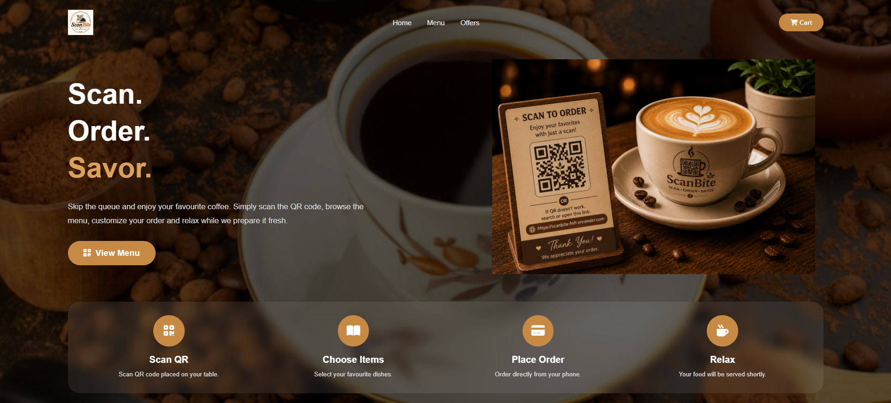
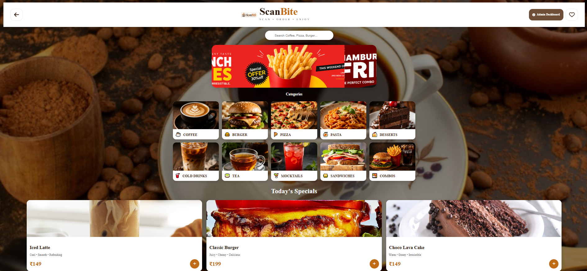
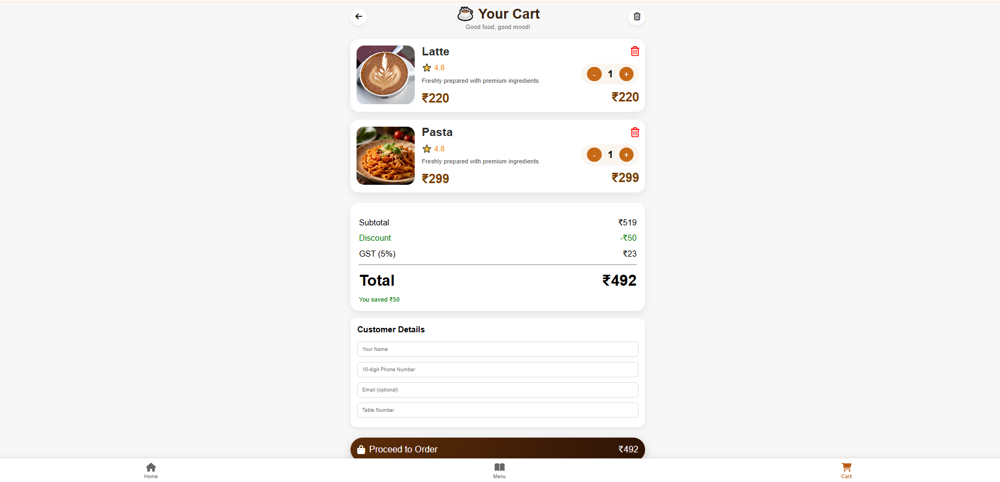
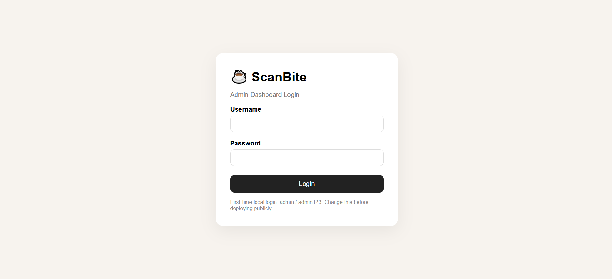
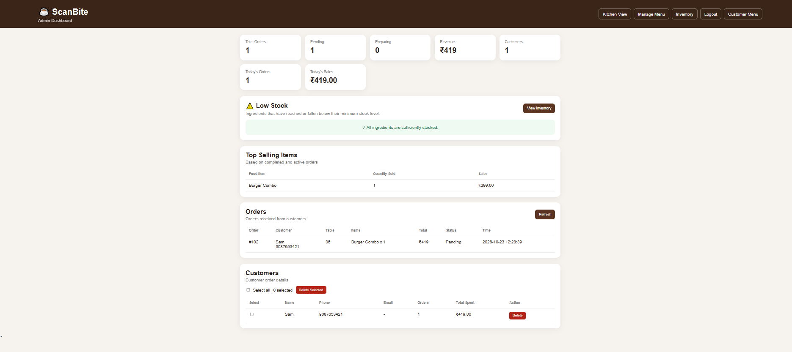
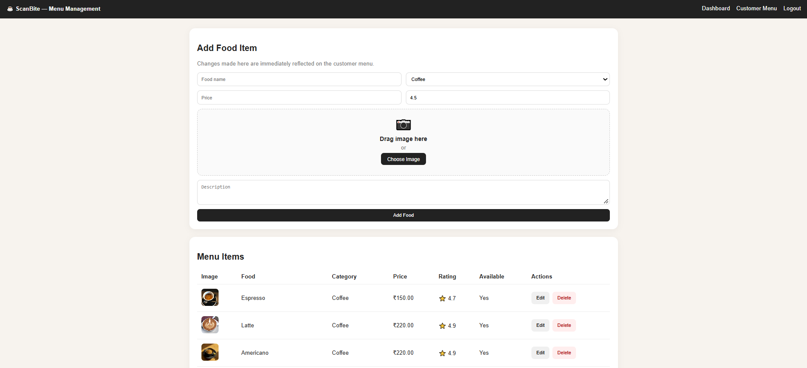
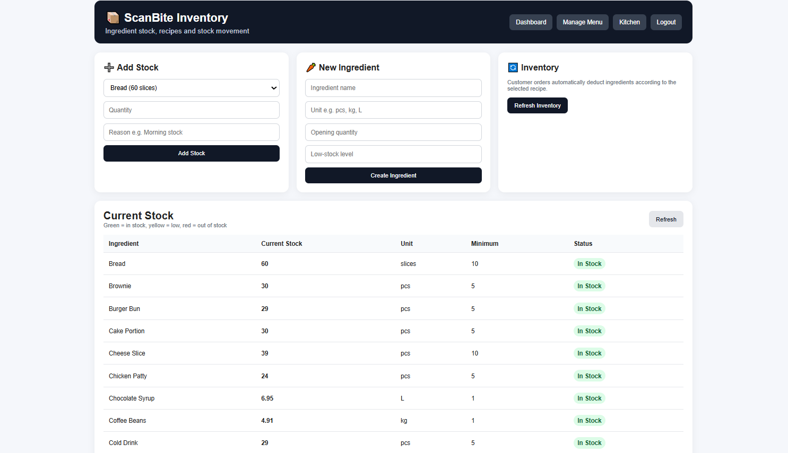
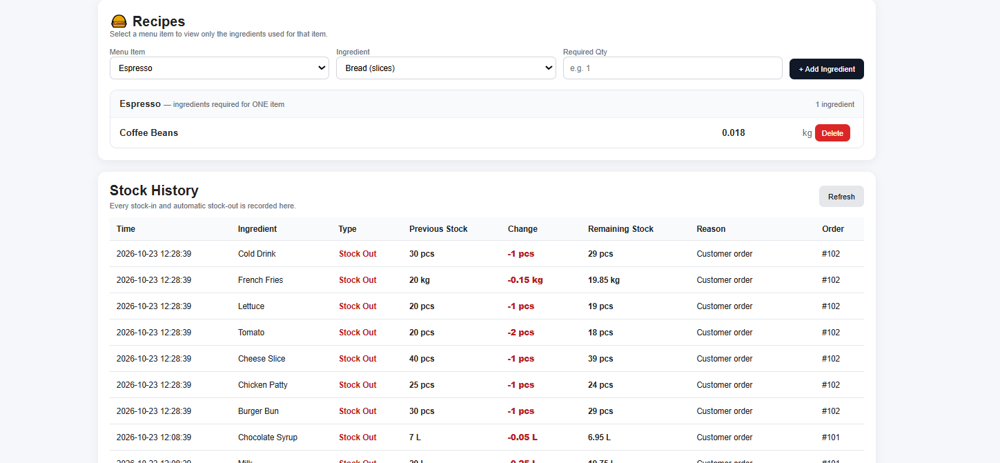

# ScanBite — QR Cafe Ordering and Management

ScanBite is a Flask + SQLite web application for QR-based cafe ordering, menu administration, kitchen order tracking, and ingredient inventory management.

## Features

- Customer menu, category filtering, search, cart, and checkout
- Order tracking and kitchen status updates
- Admin dashboard and menu management
- Ingredient inventory, recipes, stock-in/stock-out history, and low-stock alerts
- QR-code generation for the deployed customer website

## Run locally (Windows PowerShell)

1. Install Python 3.10 or newer.
2. Open PowerShell in this project folder.
3. Create and activate a virtual environment:

   ```powershell
   python -m venv venv
   .\venv\Scripts\Activate.ps1
   ```

   If PowerShell blocks activation, use Command Prompt and run `venv\\Scripts\\activate.bat`, or adjust your local PowerShell policy as appropriate.

4. Install packages:

   ```powershell
   pip install -r requirements.txt
   ```

5. Set local environment variables for the first admin account (use your own strong password):

   ```powershell
   $env:SECRET_KEY = "replace-with-a-long-random-secret"
   $env:ADMIN_USERNAME = "your-admin-username"
   $env:ADMIN_PASSWORD = "your-strong-admin-password"
   ```

6. Start the app:

   ```powershell
   python app.py
   ```

7. Open `http://127.0.0.1:5000` for the customer site. The admin login page is `/admin/login`.

The app creates `database.db` on first run. Admin credentials are read from environment variables and are not stored in source code. If the database already has an admin account, changing these environment variables will not change that existing account.

## Deploying

This repository includes a `Procfile` for a Python hosting service that supports Gunicorn (for example, Render).

1. Push this repository to GitHub.
2. Create a new **Web Service** from the GitHub repository in your hosting provider.
3. Set the build command to `pip install -r requirements.txt`.
4. Set the start command to `gunicorn app:app`.
5. Add these environment variables in the hosting provider dashboard:
   - `SECRET_KEY` — a long, random secret value
   - `ADMIN_USERNAME` — the admin username you want
   - `ADMIN_PASSWORD` — a strong, unique admin password
6. Deploy, then open the public URL. Customer pages and the admin login are part of the same app; share the public homepage/QR with customers, and keep `/admin/login` for staff.

**Important SQLite hosting note:** the database is created in the app folder. On many free hosting services, local files can be temporary and may be lost during redeploy/restart. For a real public cafe, use a persistent disk or migrate to a managed database supported by your host before relying on customer orders or inventory.

## Generate a QR code

After deployment, edit the `url` in `generate_qr.py` to your actual public customer website URL, then run:

```powershell
python generate_qr.py
```

This creates `scanbite_qr.png`. Scan it with a phone and test the customer ordering flow before printing it.

## Project structure

```text
ScanBite/
├── app.py
├── generate_qr.py
├── Procfile
├── requirements.txt
├── README.md
├── .gitignore
├── .env.example
├── templates/
└── static/
    ├── css/
    ├── js/
    └── images/
```

---

# 📸 ScanBite Project Screenshots

## 🛍️ Customer Website

### Home Page


### Menu Page


### Add to Cart


## 🔐 Admin Dashboard

### Admin Login


### Admin Dashboard


### Menu Management


### Inventory Management


### Inventory Details

